<div align="center">

# Need for Speed: Underground 2 — New 3DS UI/UX Fork

*A redesigned, 3DS-native touch experience for the unofficial native port of Need for Speed: Underground 2*

<p>
  <a href="https://github.com/MBaliver/NFSU2-3DSUI/releases/latest">
    
  </a>
  
  <a href="https://github.com/Octoblimp/NFSU2-3DS">
    
  </a>
  
  <a href="LICENSE">
    
  </a>
</p>

<p>
  <strong>🇺🇸 English</strong> &nbsp;·&nbsp; <a href="README.pt-BR.md"><strong>🇧🇷 Português (Brasil)</strong></a>
</p>

<br>

<a href="#screenshots">
  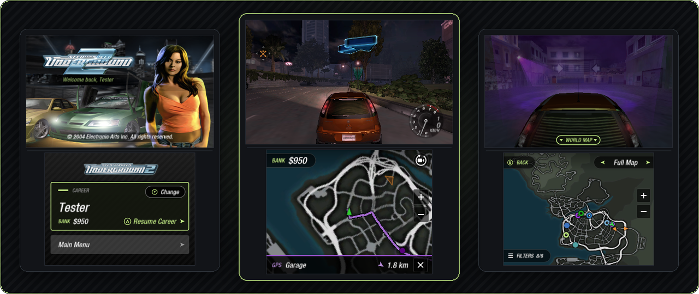
</a>

<p>
  <sub><em>Actual dual-screen captures from this fork: Title Screen Resume Career card, Free Roam full-bleed minimap with live road GPS route, and redesigned World Map.</em></sub>
</p>

<p>
  <a href="#screenshots"><strong>Screenshots</strong></a> &nbsp;•&nbsp;
  <a href="#whats-new-in-this-fork"><strong>What's New</strong></a> &nbsp;•&nbsp;
  <a href="#how-to-play-installation"><strong>How to Play</strong></a> &nbsp;•&nbsp;
  <a href="#controls--fork-options"><strong>Controls</strong></a> &nbsp;•&nbsp;
  <a href="#building-from-source"><strong>Build from Source</strong></a>
</p>

</div>

---

A UX/UI-focused fork of [Octoblimp/NFSU2-3DS](https://github.com/Octoblimp/NFSU2-3DS) (merged with upstream `v1.0.1`): an unofficial native homebrew port of the PC version of **Need for Speed: Underground 2** to the **New Nintendo 3DS / New 3DS XL / New 2DS XL**.

This is the **real PC game itself** — not a remake. Its engine was reverse-engineered from `SPEED2.EXE` and reimplemented in C (with the GameCube release as a console reference). It plays using data converted from **your own PC copy** of the game; **no copyrighted game data is included** in this repository or its releases.

You get the full PC experience — Bayview free roam, Career mode, shops, sponsors, magazine & DVD covers, SMS messages, world map, every race mode (Circuit, Sprint, Drift, Drag, Street X, URL, Outrun), Quick Race, car customization, dyno & tuning, movies, EA TRAX, saves, cheat codes, and Local Wireless multiplayer for up to 6 consoles — **upgraded with a redesigned 3DS-native touch interface, 8-language support, accessibility options, motion steering, and quality-of-life improvements.**

> [!TIP]
> **Already playing Octoblimp's NFSU2-3DS?** Your existing `sdmc:/nfsu2` data folder and career saves are **100% compatible**. Just install this fork's `NFSU2-3DS.cia` with FBI — your profiles and saves stay completely intact!

---

## Screenshots

### Menus & Hubs

<table>
  <tr>
    <td align="center" width="33%">
      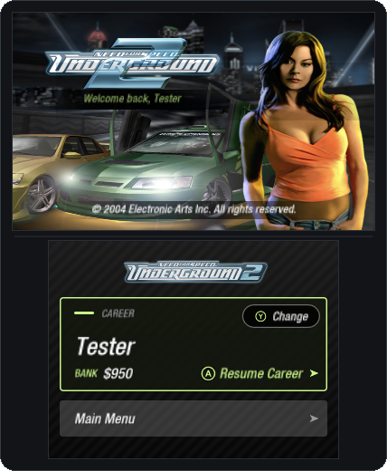<br>
      <strong>Title Screen</strong><br>
      <sub>Profile greeting &amp; one-tap <em>Resume Career</em> card</sub>
    </td>
    <td align="center" width="33%">
      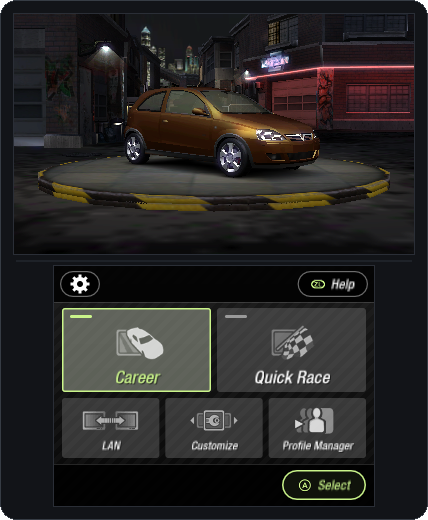<br>
      <strong>Main Menu Hub</strong><br>
      <sub>Hierarchical touch grid &amp; top-corner Options gear</sub>
    </td>
    <td align="center" width="33%">
      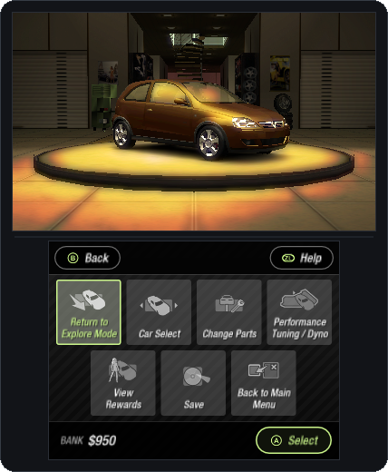<br>
      <strong>Garage Hub</strong><br>
      <sub>7-tile touch grid with Bank footer &amp; 3DS glyphs</sub>
    </td>
  </tr>
</table>

### Free Roam & GPS Navigation

<table>
  <tr>
    <td align="center" width="33%">
      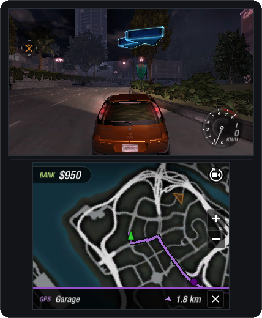<br>
      <strong>Free Roam + Live GPS Route</strong><br>
      <sub>Full-bleed zoomable map, road path &amp; real route distance</sub>
    </td>
    <td align="center" width="33%">
      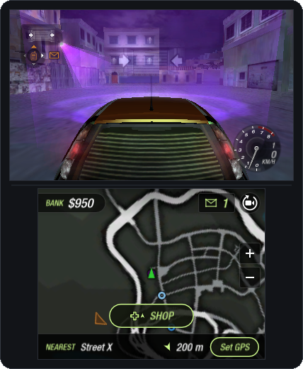<br>
      <strong>Contextual Touch HUD</strong><br>
      <sub>One-tap <code>SHOP</code>/<code>EVENT</code> pill, unread SMS chip &amp; <code>Set GPS</code></sub>
    </td>
    <td align="center" width="33%">
      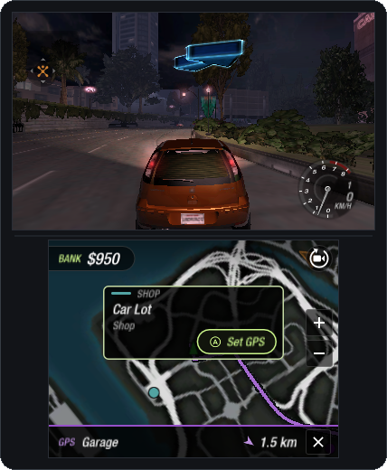<br>
      <strong>Interactive Marker Cards</strong><br>
      <sub>Tap any shop or event icon on the map to set GPS</sub>
    </td>
  </tr>
</table>

### World Map & Racing

<table>
  <tr>
    <td align="center" width="33%">
      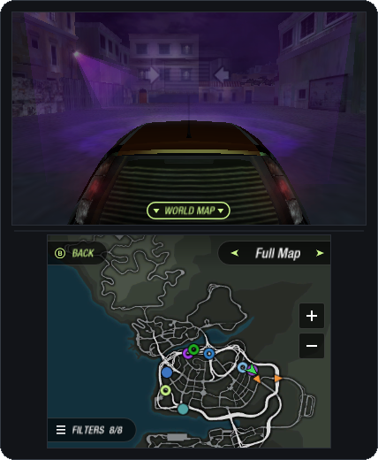<br>
      <strong>World Map Overhaul</strong><br>
      <sub>HUD-matching icons, live free-roam AI racers &amp; touch pan</sub>
    </td>
    <td align="center" width="33%">
      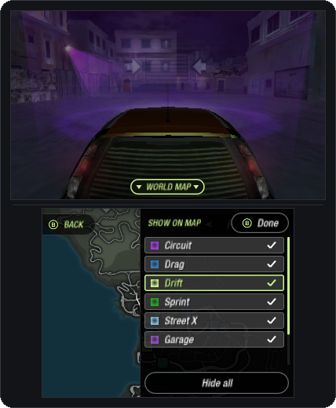<br>
      <strong>Map Filter Drawer</strong><br>
      <sub>Scrollable side sheet to toggle shops &amp; race types</sub>
    </td>
    <td align="center" width="33%">
      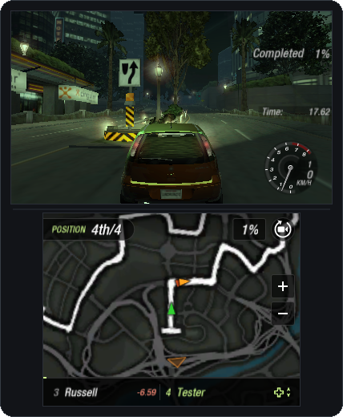<br>
      <strong>Race HUD &amp; Standings</strong><br>
      <sub>Floating position/progress chips, Touch Camera &amp; standings bar</sub>
    </td>
  </tr>
</table>

### Events, Pause & Settings

<table>
  <tr>
    <td align="center" width="33%">
      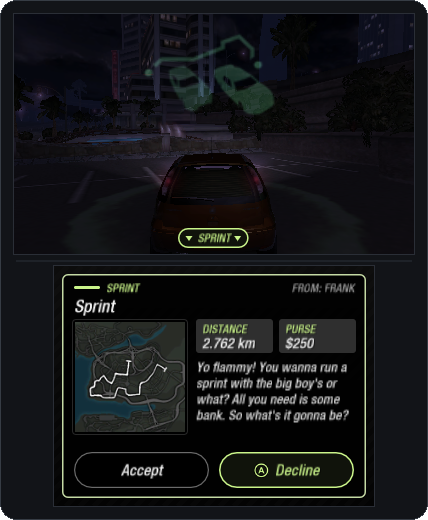<br>
      <strong>Event Engage Dialogs</strong><br>
      <sub>Track layout preview, purse, distance &amp; scrollable brief</sub>
    </td>
    <td align="center" width="33%">
      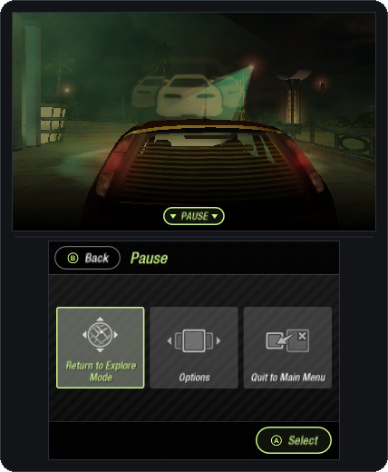<br>
      <strong>Pause Menu</strong><br>
      <sub>Top-screen bottom cue ramp &amp; clean touch card controls</sub>
    </td>
    <td align="center" width="33%">
      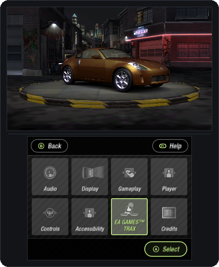<br>
      <strong>Options &amp; Accessibility</strong><br>
      <sub>Includes new <em>Accessibility</em> page (8 languages, Large Text, High Contrast)</sub>
    </td>
  </tr>
</table>

<details>
<summary><strong>More screenshots — Audio Sliders, EA Trax, Quick Race, Career Stats &amp; Localization</strong></summary>
<br>
<table>
  <tr>
    <td align="center" width="33%">
      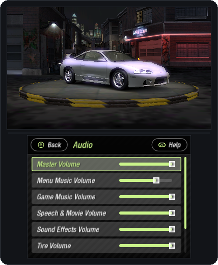<br>
      <strong>Audio Sliders</strong><br>
      <sub>Smooth touch sliders &amp; draggable scrollbar</sub>
    </td>
    <td align="center" width="33%">
      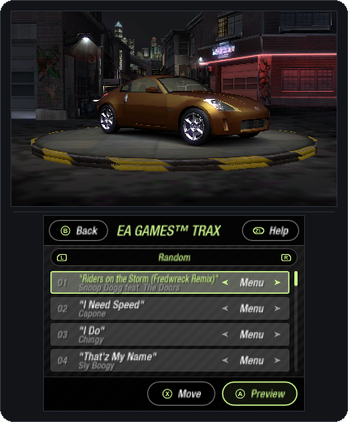<br>
      <strong>EA GAMES™ TRAX</strong><br>
      <sub>Filter rotation, reorder tracks &amp; preview on touch</sub>
    </td>
    <td align="center" width="33%">
      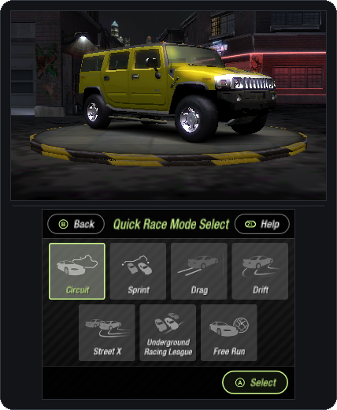<br>
      <strong>Quick Race Modes</strong><br>
      <sub>Centered 7-mode touch grid</sub>
    </td>
  </tr>
  <tr>
    <td align="center" width="33%">
      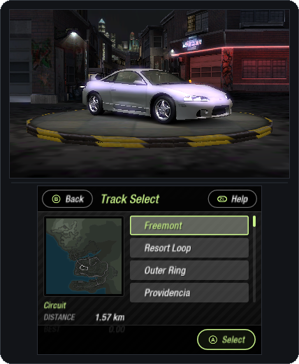<br>
      <strong>Track Select</strong><br>
      <sub>Course preview map, distance &amp; scrollable track list</sub>
    </td>
    <td align="center" width="33%">
      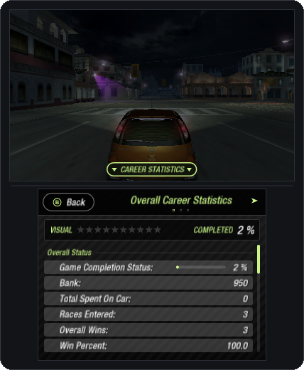<br>
      <strong>Career Statistics</strong><br>
      <sub>Visual star rating, completion bar &amp; tabbed status pages</sub>
    </td>
    <td align="center" width="33%">
      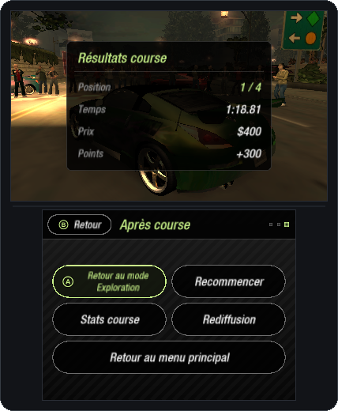<br>
      <strong>Post-Race &amp; 8 Languages</strong><br>
      <sub>Full localization of game text &amp; custom port UI strings</sub>
    </td>
  </tr>
</table>
</details>

---

## What's New in This Fork

Everything below lives inside the 3DS executable while preserving full compatibility with retail save files and upstream SD game data (read [docs/bottom-screen-ui.md](docs/bottom-screen-ui.md) for the deep-dive technical write-up):

| Area | Improvements |
| --- | --- |
| **3DS-Native UI Kit (`U2-UI`)** | ~90 frontend and in-world screens rebuilt for 320×240 using NFSU2's visual language: antialiased vector shapes (`uiaa`), ≥ 32 px touch targets, readable text floors (12 px labels / 14–16 px body), touch sound feedback, draggable scrollbars, scrollable long dialogs, and direct-tap selection. |
| **Free Roam & Race Touch HUD** | Full-bleed zoomable/pannable minimap, **live road-following GPS route** with **actual road distance**, target-colored GPS rings & strip, interactive marker cards (`Set GPS`), floating Bank/SMS chips, contextual `SHOP`/`EVENT` pill, optional **Touch Camera** button, checkered finish flag, and expandable race **Standings** bar. |
| **World Map Overhaul** | Full-screen touch map with HUD-matching icons, live free-roam AI racers, direct marker tap across categories, and a scrollable filter drawer. |
| **Faster Boot & Flow** | Title screen **Resume Career** profile card (skips the main-menu flash/stall; single press skips intro), faster world-entry loading (primes only nearby sections) with bottom-screen controls/tips, bottom-screen **Pause** & **Post-Race** menus, and a full touch **Replay Deck** with scrubbable timeline. |
| **8 Languages + Accessibility** | Full support for **English, Français, Deutsch, Italiano, Español, Nederlands, Svenska, and Dansk** (game tables + all custom port strings & tips), plus **Large Text** (~1.25×) and **High Contrast** under *Options > Accessibility* — stored in a separate `port.txt` file so retail saves stay byte-for-byte intact. |
| **3DS Controls** | **Motion Steering** (*Options > Player*, tilt using the 3DS accelerometer), **Drag Shift: ZL/ZR** & **Touch Camera** (*Options > Gameplay*), and **C-Stick Free Look** in chase cameras. |
| **Modern Toolchain & Linux Build** | Native Linux build script (`tools/build_cia.sh`), runtime `citro2d` 1.6 / 1.7+ text measurement detection, and `libctru` 2.7.1 compatibility. |

---

## Requirements

> [!IMPORTANT]
> **New Nintendo 3DS / New 3DS XL / New 2DS XL only.** Original Old 3DS / Old 3DS XL / Old 2DS models cannot run this port due to RAM and CPU requirements.

- **New 3DS, New 3DS XL, or New 2DS XL** with Custom Firmware (**Luma3DS**) and **FBI**.
- **DSP Firmware** dumped for sound:
  - Open **Rosalina** (`L + D-Pad Down + SELECT`) → **Miscellaneous options** → **Dump DSP firmware**.
  - This writes `sdmc:/3ds/dspfirm.cdc` (for `.3dsx`) or `sdmc:/dspfirm.cdc` (for `.cia` — if you only have it in `/3ds/dspfirm.cdc`, copy it to the SD root `sdmc:/dspfirm.cdc` as well).
- **Your own PC copy** of *Need for Speed: Underground 2* (the folder containing `SPEED2.EXE`).
  - Tested with the **US version patched to v1.2**. Other versions/patches are not guaranteed to work.
- About **2.6 GB** of free space on your SD card.
- A PC (Windows, Linux, or macOS) to convert your PC files once for the SD card.

---

## How to Play (Installation)

### Option 1 — Upgrading from Octoblimp's NFSU2-3DS

Already have a working `sdmc:/nfsu2` folder?

1. Download **`NFSU2-3DS.cia`** from the [**Releases**](https://github.com/MBaliver/NFSU2-3DSUI/releases/latest) page.
2. Copy it to your SD card and install it with **FBI** (cleanly replaces the app while keeping all your data and saves).
3. *(Optional — extra languages)* Copy any additional language tables (`French.bin`, `German.bin`, `Italian.bin`, `Spanish.bin`, `Dutch.bin`, `Swedish.bin`, `Danish.bin`) from your PC game's `LANGUAGES/` folder into `sdmc:/nfsu2/LANGUAGES/`, then pick your language in **Options > Accessibility > Language**.
4. Launch from the **HOME Menu**!

### Option 2 — First-Time Setup (Windows GUI)

1. **Convert your PC game files to the SD card:**
   - **Recommended:** Grab `NFSU2-3DS-Tools.zip` from [Octoblimp's v1.0.1 release](https://github.com/Octoblimp/NFSU2-3DS/releases) (bundles `ffmpeg.exe`, `vgmstream`, `dspenc`, and `tex3ds` — nothing to install), **or** clone this repo with **Git LFS** and open [`PC Apps/NFSU2-3DS Tools`](PC%20Apps/NFSU2-3DS%20Tools).
     > [!NOTE]
     > `ffmpeg.exe` is tracked with Git LFS, so GitHub's "Download ZIP" only contains a small pointer file. Use the Tools zip, clone with Git LFS, or have `ffmpeg` (with `libx264`) on your `PATH`.
   - Open **NFSU2-3DS Data Setup** (`NFSU2-3DS Data Setup.exe`).
   - Select your PC NFSU2 install folder (where `SPEED2.EXE` is) and set the output folder to `nfsu2` at the **root of your SD card** (e.g., `E:\nfsu2`).
   - Click **Set up / update** (the first run takes a while; subsequent runs only redo what changed).
   - *(Optional — extra languages)* Copy additional `LANGUAGES\<Lang>.bin` files from your PC install into `<SD>:\nfsu2\LANGUAGES\` (or run this fork's `tools/stage.py`, which copies them automatically).
   - *Command-line equivalent:*
     ```cmd
     nfsu2-3ds.exe setup --pc "C:\Path\To\NFSU2" --gamedir E:\nfsu2
     nfsu2-3ds.exe setup --pc "C:\Path\To\NFSU2" --gamedir E:\nfsu2 --list
     ```
2. **Install & Play:**
   - Download **`NFSU2-3DS.cia`** from this repository's [**Releases**](https://github.com/MBaliver/NFSU2-3DSUI/releases/latest) page (or [build it from source](#building-from-source)).
   - Install with **FBI** and launch from the **HOME Menu**.

> [!NOTE]
> **CIA vs `.3dsx`:** Always prefer the **`.cia`** on real hardware — only the CIA gets the New 3DS 178 MB extended memory mode. First boot automatically creates `sdmc:/nfsu2_config.txt` pointing to `/nfsu2`. Profiles and career saves live in `sdmc:/nfsu2/SAVE/` and `sdmc:/nfsu2/profiles/` and are never touched by Data Setup. If a required file is missing, the game displays a diagnostic screen showing the exact missing path.

### Option 3 — First-Time Setup (Linux / macOS / Python CLI)

1. Install **Python 3** dependencies:
   ```bash
   pip install numpy Pillow lz4 pefile unicorn capstone
   ```
2. Ensure these tools are on your `PATH`: `ffmpeg` (with `libx264`), `vgmstream-cli`, `dspenc` (source in `PC Apps/NFSU2-3DS Tools/bin/dspenc.c`), and devkitPro's `tex3ds` (`sudo dkp-pacman -S 3dstools`).
3. Run the staging script (automatically copies all available language `.bin` files too!):
   ```bash
   python3 tools/stage.py --pc "/path/to/NFSU2" --gamedir "/path/to/sd/nfsu2"
   ```
   Or launch the GUI with `python3 tools/nfsu2_setup.pyw`.

<details>
<summary><strong>Regional Cars (Peugeot 106 / Corsa) &amp; <code>SDATA\sdat.viv</code> Audio Notes</strong></summary>

- **Peugeot 106 & Vauxhall/Opel Corsa:** Only included in the UK/EU PC release (US installs have `CIVIC` and `RSX`). Data Setup packs whichever car folders exist and skips missing ones. To add the 106 and Corsa to a US install, copy `CARS\PEUGOT106` and `CARS\CORSA` from a UK/EU copy into your PC install's `CARS` folder before running Data Setup (or re-run Data Setup afterward), then set [`Region=`](#configuration-file-nfsu2_configtxt) accordingly (`EU`, `ALL`, etc.). Without those folders, keep `Region=US`.
- **Music & Speech in `SDATA\sdat.viv`:** Some PC installs pack music and speech into `SDATA\sdat.viv` instead of `pfdata`/`speech` folders. Data Setup unpacks it automatically into a temporary cache without altering your PC install.

</details>

---

## Controls & Fork Options

### Driving

| Control | Action |
| --- | --- |
| **Circle Pad** *(or 3DS Tilt with Motion Steering)* | Steer |
| **A** / **B** | Accelerate / Brake & Reverse |
| **R** / **L** | Nitrous / Handbrake |
| **X** / **Y** | Shift up / Shift down |
| **ZR** / **ZL** | Change camera / Reset car *(or Shift up/down in Drag races when **Drag Shift: ZL/ZR** is On)* |
| **C-Stick** | Free look camera (chase views) / Hydraulics / Pan map |
| **SELECT** | Look back |
| **D-Pad Up** | Enter shop / Challenge opponent |
| **D-Pad Down** | World Map (free roam) / Toggle Standings (in races) |
| **D-Pad Left** / **Right** | Career Statistics / SMS Messages |
| **START** | Pause |

Every driving action except steering and pause can be remapped per profile in **Options > Controls** (**Default Settings** restores defaults; **Delete All Controls** clears all bindings).

### Extra Options in This Fork

- **Options > Accessibility:** `Language` (8 languages), `Large Text`, `High Contrast`.
- **Options > Gameplay:** `GPS Color`, `Drag Shift: ZL/ZR`, `Touch Camera`, `Car Damage`.
- **Options > Player:** `Motion Steering` (3DS accelerometer tilt steering while driving).

---

## Local Wireless, Cheats & Mods

- **Local Wireless (LAN):** Race **2 to 6 New 3DS consoles** in any race mode via **LAN** on the main menu. Each console needs its own SD game data built with the same tool version.
- **Cheat Codes:** All PC cheat codes work on the title screen via 3DS button sequences — see [CHEAT_CODES.MD](CHEAT_CODES.MD).
- **Mods:** Most PC data mods (car models/textures, vinyls, HUD/menu art, text, audio, music) work via **NFSU2-3DS Mod Packer** into `<GameDir>/mods/`. Code mods (`.asi`, `SPEED2.EXE` patches) cannot run on 3DS — see [MODDING.md](MODDING.md).

---

## Configuration File (`nfsu2_config.txt`)

Located at `sdmc:/nfsu2_config.txt` (or beside the `.3dsx`). Created automatically on first boot and never overwritten.

| Key | Description |
| --- | --- |
| `GameDir=/nfsu2` | Path to the game data folder on the SD card (**required**). |
| `Language=EN` | Boot language (`EN`, `FR`, `DE`, `IT`, `ES`, `NL`, `SV`, `DA`). Requires matching `LANGUAGES/<Name>.bin`. Also configurable per profile in *Options > Accessibility*. |
| `Region=US` | Regional variant (`US`, `EU`, `KR`, `JP`, `TW`, `CN`, `TH`, or `ALL`). |
| `Mods=CarPack,HudSkin` | Comma-separated mod load order from `mods/` (`Mods=off` disables all; omitted loads all). |
| `HwVideo=0` | Decode movies on CPU (software VP6) instead of New 3DS MVD hardware. |
| `DebugLogging=1` | Write diagnostic log to `sdmc:/nfsu2_debug.txt` (off by default). |
| `DevCommands=1` | *(Developer)* Poll `sdmc:/nfsu2_cmd.txt` (`tools/devcmd.py`) and enable Debug Tools on `L + R + SELECT`. |
| `DbgUiAudit=1` | *(Developer)* Log UI touch targets under 32 px and text under 14 px. |

<details>
<summary><strong>Supported Regions Table (<code>Region=</code>)</strong></summary>
<br>

| `Region=` | Version | Notes |
| --- | --- | --- |
| `US` (`NA`) | North America *(default)* | Civic & RSX, US badges (Miata, Tiburon), Best Buy vinyl |
| `EU` (`EUROPE`, `UK`) | Europe | Peugeot 106 & Vauxhall Corsa, MX-5, Hyundai Coupe |
| `KR` (`KOREA`) | Korea | 106 & Opel Corsa, MX-5, Hyundai Tuscani |
| `JP` (`JAPAN`) | Japan | 106 & Opel Corsa, Miata Roadster, Sprinter Trueno, Altezza, Fairlady Z, Skyline |
| `TW` / `CN` / `TH` | Taiwan / China / Thailand | 106 & Opel Corsa, MX-5, Hyundai Coupe |
| `ALL` | Combined *(31 cars)* | US badges + EU 106/Corsa + US starters + Best Buy vinyl |

</details>

---

## Building from Source

### Prerequisites

- **devkitPro 3DS toolchain:** `3ds-dev` (`devkitARM`, `libctru`, `citro2d`, `citro3d`, `3dstools`, `picasso`) + `3ds-zlib` (`libz`).
- **Python 3** *(recommended)* — runs `tools/pica_output_check.py` (catches PICA200 shader bugs that freeze real hardware) and optionally regenerates the HOME Menu banner (`tools/make_banner.py`). Without Python or PC data, the committed banner in `3DS Files/meta/nfsu2/` is used.
- **SDK version note:** Upstream originally tested with `libctru 2.4.1`, `citro2d 1.6.0`, and `citro3d 1.7.1`. This fork adds runtime `citro2d 1.7.x` text measurement compatibility and `libctru 2.7.1` support, and its releases are built and tested on Linux with modern devkitPro (`libctru 2.7.1` + `citro2d 1.7.x`).

### Building on Linux

1. **Install devkitPro 3DS packages** (via [devkitPro pacman](https://devkitpro.org/wiki/devkitPro_pacman)):
   ```bash
   sudo dkp-pacman -S 3ds-dev 3ds-zlib
   ```
2. **Place Linux `makerom` and `bannertool` in `tools/3ds-bin/`:**
   Download Linux x86_64 binaries for [`makerom`](https://github.com/3DSGuy/Project_CTR/releases) and [`bannertool`](https://github.com/Steveice10/bannertool/releases), put them in `tools/3ds-bin/`, and mark them executable:
   ```bash
   chmod +x tools/3ds-bin/makerom tools/3ds-bin/bannertool
   ```
3. **Run the Linux build script** (uses `unshare -rm` to bind-mount `3DS Files/` onto space-free `build_3ds/` so GNU Make works cleanly):
   ```bash
   # Standard system devkitPro install (/opt/devkitpro):
   DEVKITPRO=/opt/devkitpro bash tools/build_cia.sh

   # Or user-local install (~/.local/share/devkitpro/opt/devkitpro, script default):
   bash tools/build_cia.sh
   ```
4. **Outputs:** `3DS Files/NFSU2-3DS.cia`, `3DS Files/NFSU2-3DS.3dsx`, and `3DS Files/NFSU2-3DS.elf`.

*(Tip: You can push & install the built `.cia` straight to your 3DS over Wi-Fi using **3dsDL** — see [docs/bottom-screen-ui.md](docs/bottom-screen-ui.md#1-build-and-deploy-on-linux).)*

### Building on Windows

1. Install **devkitPro** via the [devkitPro Installer](https://github.com/devkitPro/installer/releases) (check **3DS Development**) and ensure `3ds-zlib` is installed inside devkitPro MSYS2:
   ```bash
   pacman -S 3ds-dev 3ds-zlib
   ```
2. Windows `makerom.exe` and `bannertool.exe` are already included in `tools/3ds-bin/`.
3. From the repository root in **PowerShell**:
   ```powershell
   powershell -ExecutionPolicy Bypass -File tools/build_cia.ps1
   ```
   The script maps a temporary space-free drive letter (`subst`), checks shaders, builds `3DS Files/NFSU2-3DS.3dsx` and `3DS Files/NFSU2-3DS.cia`, and unmaps the drive automatically.

### Building the PC Data Tools (Optional)

```bash
python tools/build_apps.py
```

### Repository Layout

- `3DS Files/` — devkitARM project: `source/` (C/C++ port & PICA200 shaders), `data/` (embedded fonts & 3DS button glyphs), `meta/` (CIA banner, icon, `app.rsf`).
- `tools/` — build scripts (`build_cia.sh`, `build_cia.ps1`), Python staging & dev tools (`stage.py`, `devcmd.py`), Ghidra scripts, `tools/3ds-bin/`.
- `PC Apps/NFSU2-3DS Tools/` — Windows Data Setup & Mod Packer executables, source, and bundled utilities (`ffmpeg`, `vgmstream`, `dspenc`, `tex3ds`).
- `docs/` — UI rework write-up ([bottom-screen-ui.md](docs/bottom-screen-ui.md)), showcase screenshots (`docs/screenshots/`), file formats, and retail behavior docs.

---

## Reporting a Bug

Add `DebugLogging=1` to `sdmc:/nfsu2_config.txt`, reproduce the issue, and share `sdmc:/nfsu2_debug.txt` along with any Luma3DS crash dump and the release/commit you tested.

---

## About, Credits & License

- **Original Port:** Created by [**Octoblimp**](https://github.com/Octoblimp/NFSU2-3DS).
- **UI/UX Fork:** Maintained by [**MBaliver**](https://github.com/MBaliver/NFSU2-3DSUI).
- **Disclaimer:** Non-commercial fan project, not made, endorsed, or supported by Electronic Arts. *Need for Speed* and *Need for Speed: Underground 2* are trademarks of Electronic Arts Inc. This repository ships no copyrighted game data and requires files from a PC copy you own (the sole exception is the CIA HOME Menu banner, icon, and sound in `3DS Files/meta/nfsu2/` generated by `tools/make_banner.py` so the CIA builds standalone).
- **License:** Source code is licensed under the **GNU General Public License v3.0** ([LICENSE](LICENSE)). Game data and artwork remain property of Electronic Arts. Bundled third-party binaries keep their own licenses.

### AI Disclosure

- **Upstream port (Octoblimp):** Claude Opus 5.5 and Claude Fable 5.2 were used to help decompile the PC game, port it to the 3DS, and debug in Azahar, with real-hardware testing on a New Nintendo 3DS XL.
- **UI/UX fork (MBaliver):** Claude Opus 5.5 assisted in implementing and refining the redesigned lower-screen UI kit, localization, accessibility, and touch/motion controls alongside human UX design, emulator verification (Azahar), and real-hardware testing on New 3DS.
