<div align="center">

# Need for Speed: Underground 2 — Fork de UI/UX para New 3DS

*Uma experiência touch nativa e redesenhada para o port não oficial de Need for Speed: Underground 2 no New 3DS*

<p>
  <a href="https://github.com/MBaliver/NFSU2-3DSUI/releases/latest">
    
  </a>
  
  <a href="https://github.com/Octoblimp/NFSU2-3DS">
    
  </a>
  
  <a href="LICENSE">
    
  </a>
</p>

<p>
  <a href="README.md"><strong>🇺🇸 English</strong></a> &nbsp;·&nbsp; <strong>🇧🇷 Português (Brasil)</strong>
</p>

<br>

<a href="#screenshots">
  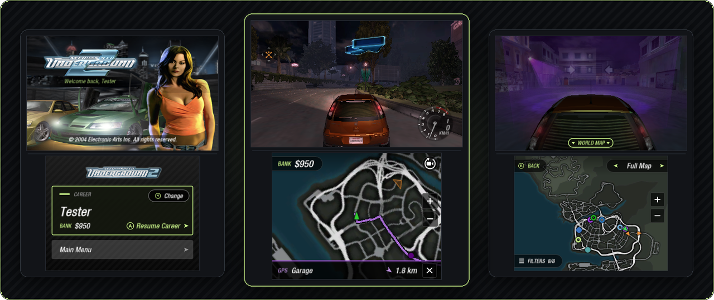
</a>

<p>
  <sub><em>Capturas reais de tela dupla deste fork: cartão Resume Career na tela inicial, minimapa em tela cheia com rota GPS em tempo real e Mapa-Múndi redesenhado.</em></sub>
</p>

<p>
  <a href="#screenshots"><strong>Screenshots</strong></a> &nbsp;•&nbsp;
  <a href="#novidades-deste-fork"><strong>Novidades</strong></a> &nbsp;•&nbsp;
  <a href="#como-jogar-instalação"><strong>Como Jogar</strong></a> &nbsp;•&nbsp;
  <a href="#controles-e-opções-do-fork"><strong>Controles</strong></a> &nbsp;•&nbsp;
  <a href="#compilando-a-partir-do-código-fonte-build"><strong>Build</strong></a>
</p>

</div>

---

Um fork focado em UX/UI do [Octoblimp/NFSU2-3DS](https://github.com/Octoblimp/NFSU2-3DS) (atualizado com o upstream `v1.0.1`): um port homebrew nativo e não oficial da versão de PC de **Need for Speed: Underground 2** para **New Nintendo 3DS / New 3DS XL / New 2DS XL**.

Este é o **próprio jogo de PC** — não um remake. O código foi obtido por engenharia reversa do `SPEED2.EXE` e reimplementado em C (usando a versão de GameCube como referência de console). O jogo roda com os arquivos convertidos da **sua própria cópia de PC**; **nenhum dado protegido por direitos autorais do jogo é distribuído** neste repositório ou nas releases.

Você tem a experiência completa do PC — mundo aberto em Bayview, modo Carreira, lojas, patrocinadores, capas de revista e DVD, mensagens SMS, mapa-múndi, todos os modos de corrida (Circuit, Sprint, Drift, Drag, Street X, URL, Outrun), Quick Race, customização completa, dinamômetro e tuning, cutscenes, EA TRAX, saves, códigos de trapaça e multiplayer Local Wireless para até 6 consoles — **aprimorada com uma interface touch nativa para o 3DS, suporte a 8 idiomas, opções de acessibilidade, direção por movimento e melhorias de qualidade de vida.**

> [!TIP]
> **Já joga o NFSU2-3DS original do Octoblimp?** Sua pasta `sdmc:/nfsu2` e seus saves de carreira são **100% compatíveis**. Basta instalar o `NFSU2-3DS.cia` deste fork pelo FBI — seus perfis e saves continuam intactos!

---

## Screenshots

### Menus e Hubs

<table>
  <tr>
    <td align="center" width="33%">
      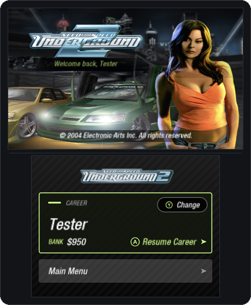<br>
      <strong>Tela Inicial</strong><br>
      <sub>Saudação ao perfil e cartão <em>Resume Career</em> em um toque</sub>
    </td>
    <td align="center" width="33%">
      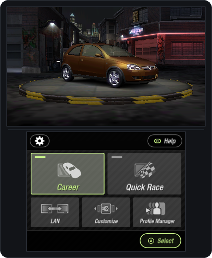<br>
      <strong>Menu Principal</strong><br>
      <sub>Grade hierárquica touch e engrenagem de Opções no topo</sub>
    </td>
    <td align="center" width="33%">
      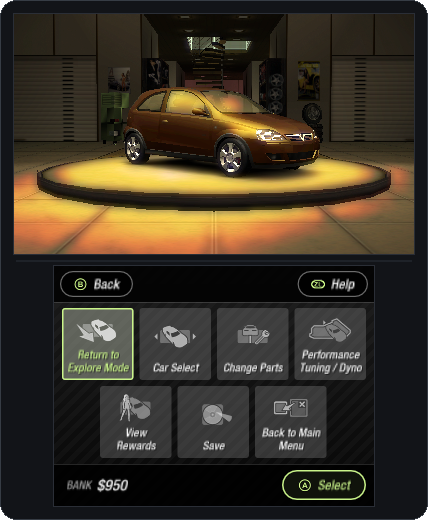<br>
      <strong>Garagem</strong><br>
      <sub>Grade touch com 7 atalhos, saldo no rodapé e ícones do 3DS</sub>
    </td>
  </tr>
</table>

### Free Roam e Navegação GPS

<table>
  <tr>
    <td align="center" width="33%">
      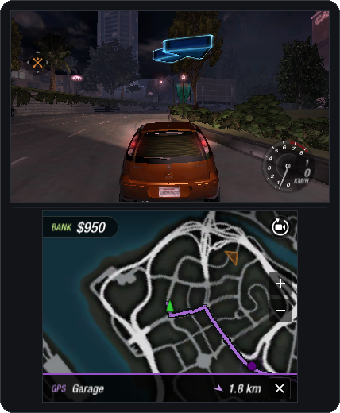<br>
      <strong>Free Roam + Rota GPS</strong><br>
      <sub>Minimapa em tela cheia com zoom, trajeto nas ruas e distância real</sub>
    </td>
    <td align="center" width="33%">
      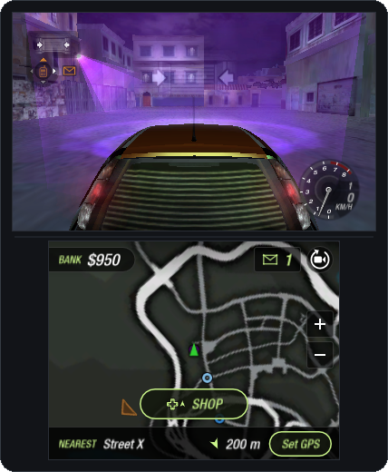<br>
      <strong>HUD Touch Contextual</strong><br>
      <sub>Botão <code>SHOP</code>/<code>EVENT</code>, alerta de SMS e <code>Set GPS</code></sub>
    </td>
    <td align="center" width="33%">
      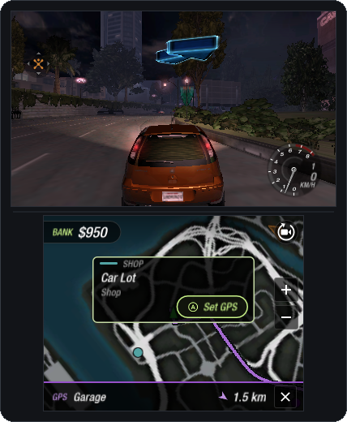<br>
      <strong>Cartões de Marcador</strong><br>
      <sub>Toque em qualquer loja ou corrida no mapa para traçar GPS</sub>
    </td>
  </tr>
</table>

### Mapa-Múndi e Corridas

<table>
  <tr>
    <td align="center" width="33%">
      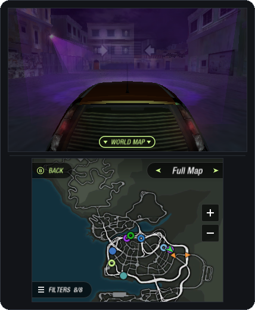<br>
      <strong>Mapa-Múndi Renovado</strong><br>
      <sub>Ícones idênticos ao HUD, corredores da IA e arraste touch</sub>
    </td>
    <td align="center" width="33%">
      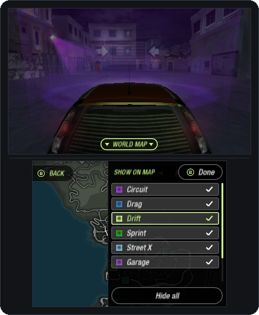<br>
      <strong>Gaveta de Filtros</strong><br>
      <sub>Painel lateral com rolagem para exibir/ocultar marcadores</sub>
    </td>
    <td align="center" width="33%">
      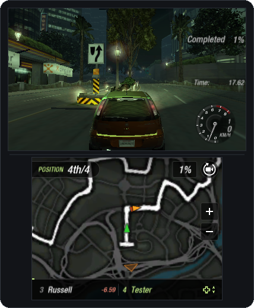<br>
      <strong>HUD de Corrida e Classificação</strong><br>
      <sub>Chips de posição/progresso, Touch Camera e barra expansível</sub>
    </td>
  </tr>
</table>

### Eventos, Pausa e Configurações

<table>
  <tr>
    <td align="center" width="33%">
      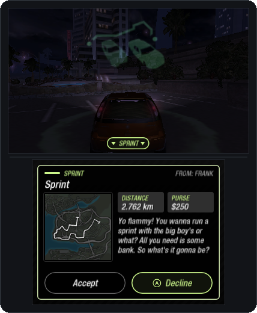<br>
      <strong>Diálogos de Evento</strong><br>
      <sub>Prévia do traçado da pista, prêmio, distância e texto rolável</sub>
    </td>
    <td align="center" width="33%">
      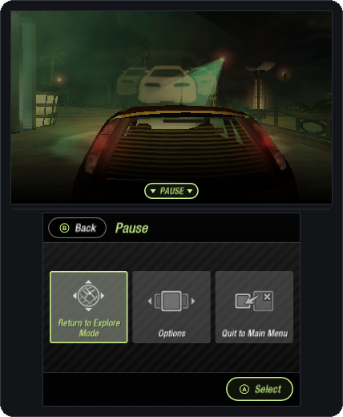<br>
      <strong>Menu de Pausa</strong><br>
      <sub>Indicador com degradê na tela superior e cartões touch embaixo</sub>
    </td>
    <td align="center" width="33%">
      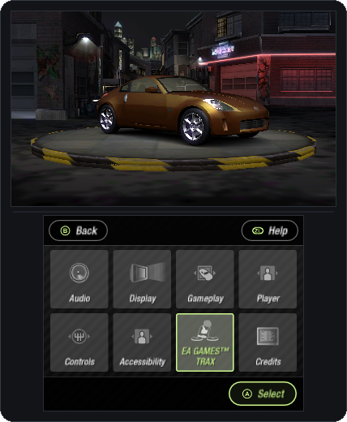<br>
      <strong>Opções e Acessibilidade</strong><br>
      <sub>Nova página <em>Accessibility</em> (8 idiomas, Texto Grande, Alto Contraste)</sub>
    </td>
  </tr>
</table>

<details>
<summary><strong>Ver mais screenshots — Áudio, EA Trax, Quick Race, Estatísticas e Localização</strong></summary>
<br>
<table>
  <tr>
    <td align="center" width="33%">
      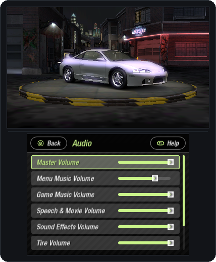<br>
      <strong>Controles de Áudio</strong><br>
      <sub>Sliders suaves por toque e barra de rolagem arrastável</sub>
    </td>
    <td align="center" width="33%">
      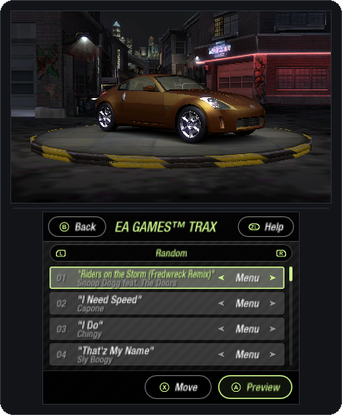<br>
      <strong>EA GAMES™ TRAX</strong><br>
      <sub>Alterne rotação, reordene faixas e ouça prévias pelo toque</sub>
    </td>
    <td align="center" width="33%">
      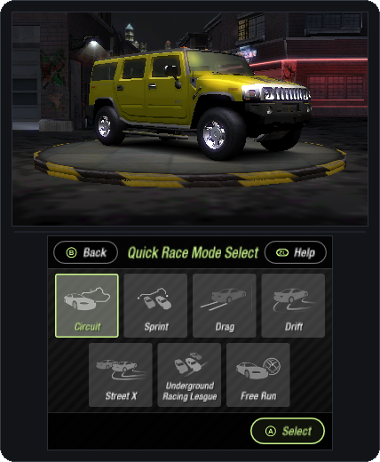<br>
      <strong>Modos do Quick Race</strong><br>
      <sub>Grade touch centralizada com os 7 modos de corrida</sub>
    </td>
  </tr>
  <tr>
    <td align="center" width="33%">
      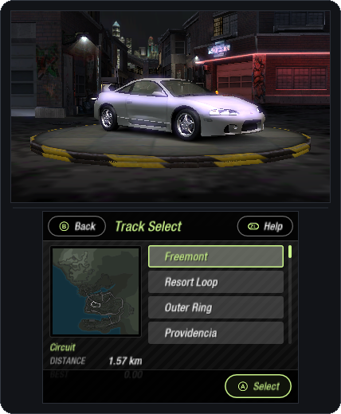<br>
      <strong>Seleção de Pista</strong><br>
      <sub>Prévia do traçado, distância e lista rolável de pistas</sub>
    </td>
    <td align="center" width="33%">
      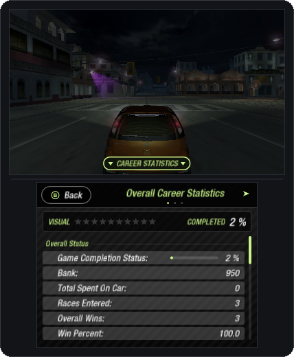<br>
      <strong>Estatísticas da Carreira</strong><br>
      <sub>Estrelas visuais, barra de progresso e abas de status</sub>
    </td>
    <td align="center" width="33%">
      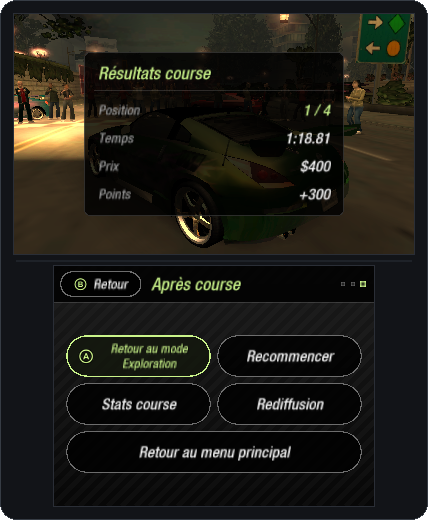<br>
      <strong>Pós-Corrida e 8 Idiomas</strong><br>
      <sub>Localização completa dos textos do jogo e da UI do port</sub>
    </td>
  </tr>
</table>
</details>

---

## Novidades deste Fork

Todas as melhorias abaixo ficam dentro do executável do 3DS, mantendo total compatibilidade com os saves originais e com os dados do projeto original (veja [docs/bottom-screen-ui.md](docs/bottom-screen-ui.md) para a documentação técnica completa):

| Área | Melhorias |
| --- | --- |
| **Kit de UI Nativo (`U2-UI`)** | ~90 telas redesenhadas para 320×240 seguindo a identidade visual do NFSU2: formas suavizadas (`uiaa`), alvos de toque ≥ 32 px, fontes legíveis (rótulos ≥ 12 px / corpo ≥ 14–16 px), feedback sonoro ao tocar, scrollbars arrastáveis, diálogos longos roláveis e toque direto. |
| **HUD Touch em Free Roam e Corridas** | Minimapa em tela cheia com zoom/arraste, **rota GPS traçada pelas ruas** com **distância real do percurso**, cores do GPS seguindo o destino, cartões interativos de marcador (`Set GPS`), chips de Banco/SMS, pílula contextual `SHOP`/`EVENT`, botão opcional **Touch Camera**, bandeira quadriculada e barra expansível de **Classificação**. |
| **Mapa-Múndi Renovado** | Mapa em tela cheia com ícones idênticos ao minimapa, corredores da IA no free roam, toque direto entre categorias e gaveta lateral de filtros com rolagem. |
| **Fluxo e Carregamento Otimizados** | Cartão **Resume Career** na tela inicial (pula a piscada/trava do menu principal; um toque pula a intro), carregamento mais rápido ao entrar no mundo com dicas e controles na tela inferior, menus touch de **Pausa** e **Pós-Corrida** e **Deck de Replay** com linha do tempo arrastável. |
| **8 Idiomas + Acessibilidade** | Suporte a **English, Français, Deutsch, Italiano, Español, Nederlands, Svenska e Dansk** (textos do jogo + strings e dicas do port), além de **Texto Grande** (~1,25×) e **Alto Contraste** em *Options > Accessibility* — salvos em um arquivo `port.txt` separado para preservar os saves originais byte a byte. |
| **Controles para 3DS** | **Motion Steering** (*Options > Player*, direção inclinando o console via acelerômetro), **Drag Shift: ZL/ZR** e **Touch Camera** (*Options > Gameplay*), e **Câmera Livre no C-Stick**. |
| **Toolchain Moderna e Build no Linux** | Script nativo de build para Linux (`tools/build_cia.sh`), detecção automática da medição de texto do `citro2d` 1.6 / 1.7+ e compatibilidade com `libctru` 2.7.1. |

---

## Requisitos

> [!IMPORTANT]
> **Exclusivo para New Nintendo 3DS / New 3DS XL / New 2DS XL.** Consoles Old 3DS / Old 3DS XL / Old 2DS não conseguem rodar o port por limitações de memória RAM e CPU.

- Um **New 3DS, New 3DS XL ou New 2DS XL** com Custom Firmware (**Luma3DS**) e **FBI**.
- **Firmware DSP** extraído para o áudio:
  - Abra o **Rosalina** (`L + D-Pad Baixo + SELECT`) → **Miscellaneous options** → **Dump DSP firmware**.
  - Isso cria `sdmc:/3ds/dspfirm.cdc` (para `.3dsx`) ou `sdmc:/dspfirm.cdc` (para `.cia` — se só existir em `/3ds/dspfirm.cdc`, copie também para a raiz do SD em `sdmc:/dspfirm.cdc`).
- **Sua própria cópia de PC** de *Need for Speed: Underground 2* (a pasta onde fica o `SPEED2.EXE`).
  - Testado com a **versão americana (US) atualizada para v1.2**. Outras versões/patches não têm garantia de funcionamento.
- Cerca de **2,6 GB** livres no cartão SD.
- Um PC (Windows, Linux ou macOS) para converter os arquivos do jogo uma única vez para o cartão SD.

---

## Como Jogar (Instalação)

### Opção 1 — Atualizando a partir do NFSU2-3DS do Octoblimp

Já tem a pasta `sdmc:/nfsu2` funcionando?

1. Baixe o **`NFSU2-3DS.cia`** na página de [**Releases**](https://github.com/MBaliver/NFSU2-3DSUI/releases/latest).
2. Copie para o cartão SD e instale pelo **FBI** (substitui o app mantendo seus dados e saves intactos).
3. *(Opcional — outros idiomas)* Copie os arquivos de idioma desejados (`French.bin`, `German.bin`, `Italian.bin`, `Spanish.bin`, `Dutch.bin`, `Swedish.bin`, `Danish.bin`) da pasta `LANGUAGES/` do seu jogo de PC para `sdmc:/nfsu2/LANGUAGES/` e selecione o idioma em **Options > Accessibility > Language**.
4. Abra pelo **Menu HOME**!

### Opção 2 — Instalação do Zero (Windows — Interface Gráfica)

1. **Converta os arquivos da sua cópia de PC para o cartão SD:**
   - **Recomendado:** Baixe o `NFSU2-3DS-Tools.zip` na [release v1.0.1 do Octoblimp](https://github.com/Octoblimp/NFSU2-3DS/releases) (já vem com `ffmpeg.exe`, `vgmstream`, `dspenc` e `tex3ds` prontos), **ou** clone este repositório com **Git LFS** instalado e abra [`PC Apps/NFSU2-3DS Tools`](PC%20Apps/NFSU2-3DS%20Tools).
     > [!NOTE]
     > O `ffmpeg.exe` é versionado com Git LFS, então o "Download ZIP" do GitHub traz apenas um ponteiro pequeno. Use o ZIP das ferramentas, clone com Git LFS ou tenha o `ffmpeg` (com `libx264`) no `PATH`.
   - Abra o **NFSU2-3DS Data Setup** (`NFSU2-3DS Data Setup.exe`).
   - Selecione a pasta da instalação de PC do NFSU2 (onde está o `SPEED2.EXE`) e escolha `nfsu2` na **raiz do cartão SD** como destino (ex.: `E:\nfsu2`).
   - Clique em **Set up / update** (a primeira conversão demora um pouco; execuções seguintes atualizam apenas o que mudou).
   - *(Opcional — outros idiomas)* Copie os arquivos `LANGUAGES\<Idioma>.bin` desejados do jogo de PC para `<SD>:\nfsu2\LANGUAGES\` (o `tools/stage.py` deste fork já faz isso automaticamente).
   - *Equivalente via terminal no Windows:*
     ```cmd
     nfsu2-3ds.exe setup --pc "C:\Caminho\Para\NFSU2" --gamedir E:\nfsu2
     nfsu2-3ds.exe setup --pc "C:\Caminho\Para\NFSU2" --gamedir E:\nfsu2 --list
     ```
2. **Instale e Jogue:**
   - Baixe o **`NFSU2-3DS.cia`** na página de [**Releases**](https://github.com/MBaliver/NFSU2-3DSUI/releases/latest) deste repositório (ou [compile a partir do código-fonte](#compilando-a-partir-do-código-fonte-build)).
   - Instale pelo **FBI** e abra pelo **Menu HOME**.

> [!NOTE]
> **CIA vs `.3dsx`:** Dê preferência ao **`.cia`** em hardware real — apenas o CIA recebe o modo de memória estendida de 178 MB do New 3DS. A primeira execução cria automaticamente `sdmc:/nfsu2_config.txt` apontando para `/nfsu2`. Perfis e saves ficam em `sdmc:/nfsu2/SAVE/` e `sdmc:/nfsu2/profiles/` e nunca são tocados pelo Data Setup. Se algum arquivo obrigatório estiver faltando, o jogo exibe uma tela de diagnóstico indicando o caminho exato.

### Opção 3 — Instalação do Zero (Linux / macOS / Python CLI)

1. Instale as dependências em **Python 3**:
   ```bash
   pip install numpy Pillow lz4 pefile unicorn capstone
   ```
2. Tenha no `PATH`: `ffmpeg` (com `libx264`), `vgmstream-cli`, `dspenc` (código-fonte em `PC Apps/NFSU2-3DS Tools/bin/dspenc.c`) e `tex3ds` do devkitPro (`sudo dkp-pacman -S 3dstools`).
3. Execute o script de preparação (que também copia automaticamente todos os idiomas disponíveis!):
   ```bash
   python3 tools/stage.py --pc "/caminho/para/NFSU2" --gamedir "/caminho/para/sd/nfsu2"
   ```
   Ou abra a interface gráfica com `python3 tools/nfsu2_setup.pyw`.

<details>
<summary><strong>Carros Regionais (Peugeot 106 / Corsa) e Áudio em <code>SDATA\sdat.viv</code></strong></summary>

- **Peugeot 106 e Vauxhall/Opel Corsa:** Presentes apenas na versão europeia (UK/EU) de PC (a versão US tem `CIVIC` e `RSX`). O Data Setup empacota os carros encontrados e ignora os ausentes. Para ter o 106 e o Corsa numa cópia US, copie `CARS\PEUGOT106` e `CARS\CORSA` de uma cópia UK/EU para a pasta `CARS` do seu PC antes de rodar o Data Setup (ou rode novamente depois) e configure [`Region=`](#arquivo-de-configuração-nfsu2_configtxt) (`EU`, `ALL`, etc.). Sem essas pastas, mantenha `Region=US`.
- **Música e Vozes em `SDATA\sdat.viv`:** Algumas instalações guardam músicas e vozes dentro de `SDATA\sdat.viv` em vez das pastas `pfdata`/`speech`. O Data Setup extrai tudo automaticamente para um cache temporário sem alterar a pasta do jogo no PC.

</details>

---

## Controles e Opções do Fork

### Dirigindo

| Controle | Ação |
| --- | --- |
| **Circle Pad** *(ou inclinação do 3DS com Motion Steering)* | Esterçar |
| **A** / **B** | Acelerar / Frear e Ré |
| **R** / **L** | Nitro / Freio de mão |
| **X** / **Y** | Subir marcha / Reduzir marcha |
| **ZR** / **ZL** | Mudar câmera / Resetar carro *(ou trocar marchas em Drag com **Drag Shift: ZL/ZR** ativo)* |
| **C-Stick** | Câmera livre (visões traseiras) / Hidráulica / Mover o mapa |
| **SELECT** | Olhar para trás |
| **D-Pad Cima** | Entrar em loja / Desafiar oponente |
| **D-Pad Baixo** | Mapa-Múndi (free roam) / Alternar Classificação (em corridas) |
| **D-Pad Esquerda** / **Direita** | Estatísticas da Carreira / Mensagens SMS |
| **START** | Pausar |

Todas as ações de direção (exceto esterçar e pausar) podem ser remapeadas por perfil em **Options > Controls** (**Default Settings** restaura o padrão; **Delete All Controls** limpa tudo).

### Opções Extras deste Fork

- **Options > Accessibility:** `Language` (8 idiomas), `Large Text` (texto grande), `High Contrast` (alto contraste).
- **Options > Gameplay:** `GPS Color`, `Drag Shift: ZL/ZR`, `Touch Camera`, `Car Damage`.
- **Options > Player:** `Motion Steering` (direção por inclinação usando o acelerômetro do 3DS).

---

## Local Wireless, Cheats e Mods

- **Local Wireless (LAN):** Corra com **2 a 6 consoles New 3DS** em qualquer modalidade pelo menu **LAN**. Cada console precisa da sua própria pasta de dados convertida com a mesma versão das ferramentas.
- **Códigos de Trapaça (Cheats):** Todos os códigos de PC funcionam na tela inicial com sequências de botões do 3DS — veja [CHEAT_CODES.MD](CHEAT_CODES.MD).
- **Mods:** A maioria dos mods de dados de PC (modelos/texturas de carros, vinis, arte de HUD/menus, textos, sons e músicas) funciona via **NFSU2-3DS Mod Packer** em `<GameDir>/mods/`. Mods de código (`.asi`, patches no `SPEED2.EXE`) não rodam no 3DS — veja [MODDING.md](MODDING.md).

---

## Arquivo de Configuração (`nfsu2_config.txt`)

Fica em `sdmc:/nfsu2_config.txt` (ou ao lado do `.3dsx`). Criado automaticamente no primeiro boot e nunca sobrescrito.

| Linha | O que faz |
| --- | --- |
| `GameDir=/nfsu2` | Caminho da pasta de dados do jogo na raiz do SD (**obrigatório**). |
| `Language=EN` | Idioma inicial (`EN`, `FR`, `DE`, `IT`, `ES`, `NL`, `SV`, `DA`). Requer `LANGUAGES/<Nome>.bin`. Também configurável por perfil em *Options > Accessibility*. |
| `Region=US` | Região do jogo (`US`, `EU`, `KR`, `JP`, `TW`, `CN`, `TH` ou `ALL`). |
| `Mods=CarPack,HudSkin` | Ordem de carregamento dos mods em `mods/` (`Mods=off` desativa todos; sem a linha, carrega todos). |
| `HwVideo=0` | Decodifica vídeos na CPU (VP6 por software) em vez do hardware MVD do New 3DS. |
| `DebugLogging=1` | Grava log de depuração em `sdmc:/nfsu2_debug.txt` (desligado por padrão). |
| `DevCommands=1` | *(Desenvolvedor)* Lê `sdmc:/nfsu2_cmd.txt` (`tools/devcmd.py`) e ativa ferramentas de debug em `L + R + SELECT`. |
| `DbgUiAudit=1` | *(Desenvolvedor)* Registra alvos de toque menores que 32 px e textos menores que 14 px. |

<details>
<summary><strong>Tabela de Regiões Suportadas (<code>Region=</code>)</strong></summary>
<br>

| `Region=` | Versão | Diferenças |
| --- | --- | --- |
| `US` (`NA`) | América do Norte *(padrão)* | Civic e RSX, emblemas US (Miata, Tiburon), vinil Best Buy |
| `EU` (`EUROPE`, `UK`) | Europa | Peugeot 106 e Vauxhall Corsa, MX-5, Hyundai Coupe |
| `KR` (`KOREA`) | Coreia | 106 e Opel Corsa, MX-5, Hyundai Tuscani |
| `JP` (`JAPAN`) | Japão | 106 e Opel Corsa, Miata Roadster, Sprinter Trueno, Altezza, Fairlady Z, Skyline |
| `TW` / `CN` / `TH` | Taiwan / China / Tailândia | 106 e Opel Corsa, MX-5, Hyundai Coupe |
| `ALL` | Combinada *(31 carros)* | Emblemas US + 106/Corsa europeus + iniciais US + vinil Best Buy |

</details>

---

## Compilando a partir do Código-Fonte (Build)

### Pré-requisitos

- **Toolchain 3DS do devkitPro:** `3ds-dev` (`devkitARM`, `libctru`, `citro2d`, `citro3d`, `3dstools`, `picasso`) + `3ds-zlib` (`libz`).
- **Python 3** *(recomendado)* — executa `tools/pica_output_check.py` (evita bugs de shader PICA200 que travam hardware real) e opcionalmente recria o banner do Menu HOME (`tools/make_banner.py`). Sem Python ou dados de PC, o banner já versionado em `3DS Files/meta/nfsu2/` é usado.
- **Nota sobre versões do SDK:** O projeto original foi testado com `libctru 2.4.1`, `citro2d 1.6.0` e `citro3d 1.7.1`. Este fork adiciona compatibilidade em tempo de execução com `citro2d 1.7.x` e suporte ao `libctru 2.7.1`, e suas releases são compiladas e testadas no Linux com o devkitPro atual (`libctru 2.7.1` + `citro2d 1.7.x`).

### Compilando no Linux

1. **Instale os pacotes 3DS do devkitPro** (via [devkitPro pacman](https://devkitpro.org/wiki/devkitPro_pacman)):
   ```bash
   sudo dkp-pacman -S 3ds-dev 3ds-zlib
   ```
2. **Coloque os binários Linux de `makerom` e `bannertool` em `tools/3ds-bin/`:**
   Baixe os binários Linux x86_64 de [`makerom`](https://github.com/3DSGuy/Project_CTR/releases) e [`bannertool`](https://github.com/Steveice10/bannertool/releases), coloque-os em `tools/3ds-bin/` e torne-os executáveis:
   ```bash
   chmod +x tools/3ds-bin/makerom tools/3ds-bin/bannertool
   ```
3. **Execute o script de build Linux** (usa `unshare -rm` para montar `3DS Files/` em `build_3ds/` sem espaços no caminho, contornando a limitação do GNU Make):
   ```bash
   # Instalação padrão do devkitPro (/opt/devkitpro):
   DEVKITPRO=/opt/devkitpro bash tools/build_cia.sh

   # Ou instalação local do usuário (~/.local/share/devkitpro/opt/devkitpro, padrão do script):
   bash tools/build_cia.sh
   ```
4. **Saídas geradas:** `3DS Files/NFSU2-3DS.cia`, `3DS Files/NFSU2-3DS.3dsx` e `3DS Files/NFSU2-3DS.elf`.

*(Dica: você pode enviar e instalar o `.cia` diretamente no 3DS por Wi-Fi usando o **3dsDL** — veja os comandos em [docs/bottom-screen-ui.md](docs/bottom-screen-ui.md#1-build-and-deploy-on-linux).)*

### Compilando no Windows

1. Instale o **devkitPro** pelo [devkitPro Installer](https://github.com/devkitPro/installer/releases) (marque **3DS Development**) e garanta que `3ds-zlib` esteja instalado no MSYS2 do devkitPro:
   ```bash
   pacman -S 3ds-dev 3ds-zlib
   ```
2. Os binários `makerom.exe` e `bannertool.exe` de Windows já estão incluídos em `tools/3ds-bin/`.
3. Na raiz do repositório, abra o **PowerShell** e execute:
   ```powershell
   powershell -ExecutionPolicy Bypass -File tools/build_cia.ps1
   ```
   O script mapeia temporariamente uma letra de unidade sem espaços (`subst`), valida os shaders, compila `3DS Files/NFSU2-3DS.3dsx` e `3DS Files/NFSU2-3DS.cia` e remove o mapeamento ao terminar.

### Compilando as Ferramentas de PC (Opcional)

```bash
python tools/build_apps.py
```

### Estrutura do Repositório

- `3DS Files/` — projeto devkitARM: `source/` (código C/C++ e shaders PICA200), `data/` (fontes e ícones de botões), `meta/` (banner, ícone e `app.rsf` do CIA).
- `tools/` — scripts de build (`build_cia.sh`, `build_cia.ps1`), ferramentas Python (`stage.py`, `devcmd.py`), scripts Ghidra e `tools/3ds-bin/`.
- `PC Apps/NFSU2-3DS Tools/` — executáveis Windows do Data Setup e Mod Packer, código-fonte e utilitários incluídos (`ffmpeg`, `vgmstream`, `dspenc`, `tex3ds`).
- `docs/` — documentação do retrabalho de UI ([bottom-screen-ui.md](docs/bottom-screen-ui.md)), screenshots (`docs/screenshots/`), formatos de arquivos e comportamento original do jogo.

---

## Reportando Bugs

Adicione `DebugLogging=1` ao `sdmc:/nfsu2_config.txt`, reproduza o problema e envie `sdmc:/nfsu2_debug.txt` junto com o crash dump do Luma3DS (se travou) e a versão/commit testada.

---

## Sobre, Créditos e Licença

- **Port Original:** Criado por [**Octoblimp**](https://github.com/Octoblimp/NFSU2-3DS).
- **Fork de UI/UX:** Mantido por [**MBaliver**](https://github.com/MBaliver/NFSU2-3DSUI).
- **Aviso Legal:** Projeto de fã sem fins lucrativos, não feito, endossado ou apoiado pela Electronic Arts. *Need for Speed* e *Need for Speed: Underground 2* são marcas registradas da Electronic Arts Inc. Este repositório não contém dados do jogo e funciona apenas com arquivos de uma cópia de PC que você possui (a única exceção é o banner, ícone e som do Menu HOME do CIA em `3DS Files/meta/nfsu2/`, gerados por `tools/make_banner.py` para compilar o CIA de forma independente).
- **Licença:** Código distribuído sob a **GNU General Public License v3.0** ([LICENSE](LICENSE)). Os dados e artes do jogo permanecem propriedade da Electronic Arts. Os binários de terceiros incluídos mantêm suas respectivas licenças.

### Transparência sobre Uso de IA

- **Port original (Octoblimp):** Claude Opus 5.5 e Claude Fable 5.2 foram utilizados para auxiliar na descompilação do jogo de PC, no port para 3DS e na depuração no Azahar, com testes em hardware real em um New Nintendo 3DS XL.
- **Fork de UI/UX (MBaliver):** Claude Opus 5.5 auxiliou na implementação e refinamento da nova interface da tela inferior, localização, acessibilidade e controles touch/movimento, em conjunto com design de UX humano, validação no Azahar e testes em hardware real no New 3DS.
